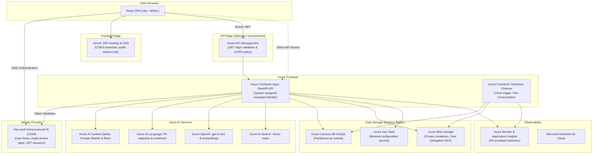
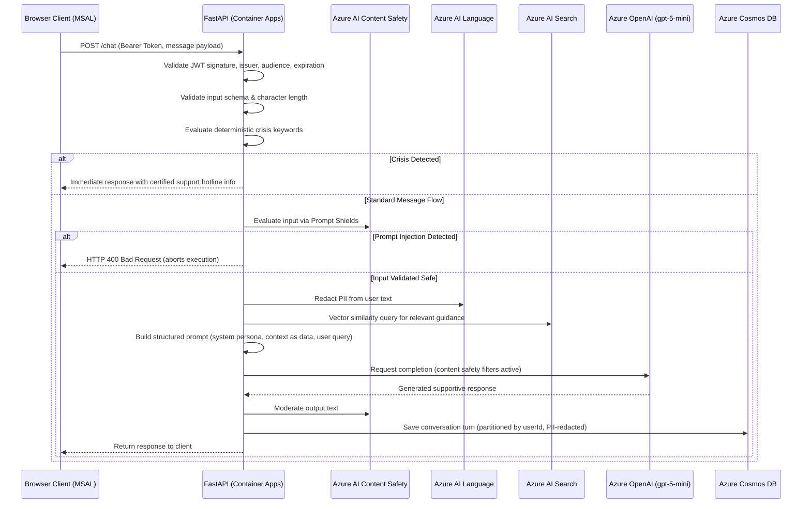

# MindGPT: Security-First Architecture (Azure)

MindGPT is an AI-powered emotional support web application built on **Microsoft Azure**. Because it processes sensitive personal discussions regarding mental well-being (classified as special-category health data under GDPR Article 9) and exposes an LLM to untrusted user input, privacy, safety, and security are integrated directly into the system architecture.

**Author:** Haitam Oualif  
**Status:** The core cloud stack is fully deployed and validated end-to-end against live Azure services (Entra External ID authentication, safety pipeline, vector retrieval, Cosmos DB persistence, private Blob image uploads, and Azure OpenAI `gpt-5-mini` inference).

---

## 1. Core Architectural Principles

1. **Identity Over Secrets:** Service-to-service communication relies on **Microsoft Entra Managed Identities** rather than static access keys or connection strings. Key-based authentication is explicitly disabled where supported (Azure Cosmos DB, Azure Blob Storage, and Azure OpenAI).
2. **Least Privilege & Per-User Isolation:** Azure RBAC roles are scoped specifically to required operations. User data is partitioned by `userId`, with authorization enforced strictly server-side.
3. **Untrusted Input as Data:** User inputs, uploaded images, and retrieved knowledge base excerpts are treated as untrusted data rather than system instructions.
4. **Privacy by Default:** Personally Identifiable Information (PII) is detected and redacted before logging or database persistence. Data retention windows and user-driven deletion options are built in.
5. **Security as Code:** All infrastructure is defined via modular Bicep templates. Continuous integration pipelines incorporate automated security linters, container image scanning, and secret detection.
6. **Fail-Closed Validation:** Requests lacking valid credentials or failing automated safety checks are immediately rejected with appropriate HTTP error codes.

---

## 2. System Overview

MindGPT consists of a modern Single-Page Application (SPA) frontend backed by a stateless REST API:

- **Conversational Core:** Authenticated chat API running each message through an AI safety pipeline, grounding responses in a curated behavioral knowledge base, and persisting conversations per user.
- **Behavioral Knowledge Base (`datasets/`):** Psychoeducational material, coping strategies, and cognitive behavioral frameworks indexed for vector search.
- **User Dashboard & Wellness:** Self-reported user profiles, personal memory notes, and emotional wellness trend graphs calculated from daily sentiment scores.
- **Private Image Attachments:** Secure image upload capability with automated content safety scanning, stored in private Blob containers and accessed via short-lived SAS tokens.

---

## 3. Architecture Topology



### Infrastructure Tiers

- **Active Deployment:** Core cloud resources deployed on cost-effective or free tiers (Azure Container Apps, Azure OpenAI, Azure AI Search, Azure AI Content Safety, Azure AI Language, Cosmos DB, Blob Storage, and Azure Functions).
- **Enterprise Reference Architecture:** Architectural specifications for enterprise deployments (Azure API Management, Microsoft Defender for Cloud plans, Azure Front Door with WAF, and Virtual Network Private Endpoints). API Management has been deployed and verified on the Consumption tier.

---

## 4. Azure Services and Security Configurations

| Functional Area | Azure Service | Configuration & Security Posture |
|---|---|---|
| Generative AI | Azure OpenAI (`gpt-5-mini`) | Managed identity authentication (`disableLocalAuth`), content safety filters enabled. |
| Vector Embeddings | Azure OpenAI (`text-embedding-3-small`) | Managed identity authentication; generates embeddings for RAG retrieval. |
| Vector Search | Azure AI Search | Vector and semantic search over psychoeducational guidance documents. |
| Authentication | Microsoft Entra External ID (CIAM) | OIDC/OAuth 2.0 PKCE flow, JWT cryptographic validation, single-tenant app registrations. |
| Database | Azure Cosmos DB (NoSQL) | Local keys disabled (`disableLocalAuth`), RBAC data-plane access, partitioned by `/userId`. |
| Storage | Azure Blob Storage | Public access blocked, private containers, short-lived User Delegation SAS tokens (maximum 1 hour). |
| Application Hosting | Azure Container Apps | Scaled-to-zero compute, system-assigned managed identity, custom response headers. |
| Background Cleanup | Azure Functions (Flex Consumption) | Timer trigger (`retention_cleanup`), keyless deployment, deletes data older than 90 days. |
| Language & Privacy | Azure AI Language | Real-time PII detection and redaction; text sentiment analysis. |
| AI Content Safety | Azure AI Content Safety | Prompt Shields for user input and documents; multi-category harm evaluation. |
| Secrets Management | Azure Key Vault | Access controlled via managed identity; soft delete and purge protection enabled. |
| Frontend Hosting | Vercel | Static React application hosting, global CDN, and HTTPS termination. |

---

## 5. End-to-End Chat Request Flow



System instructions and guardrails remain isolated inside the `system` role. The user message is passed within the `user` turn, and retrieved context is formatted as explicit reference data to prevent prompt injection or indirect overrides.

---

## 6. Repository Structure

```
MindGPT/
├─ docs/                     # Architectural documentation and setup guides
│  ├─ ARCHITECTURE.md        # Architecture overview and design patterns
│  ├─ THREAT_MODEL.md        # STRIDE and OWASP threat analysis
│  ├─ SECURITY_VALIDATION.md # Security test results and verification
│  ├─ DEPLOY.md              # Infrastructure and deployment procedures
│  └─ ENTRA_SETUP.md         # Microsoft Entra External ID setup guide
├─ frontend/                 # React Single-Page Application (TypeScript, Vite, MSAL)
├─ backend/                  # FastAPI Application (Azure SDKs, Managed Identities)
│  ├─ app/
│  │  ├─ auth/               # Entra token validation
│  │  ├─ safety/             # Prompt Shields, PII redaction, crisis detection
│  │  ├─ analysis/           # Sentiment analysis
│  │  ├─ rag/                # AI Search vector query and prompt assembly
│  │  ├─ data/               # Cosmos DB and Blob Storage repositories
│  │  └─ routers/            # API endpoints (chat, profile, memory, wellness)
│  ├─ tests/                 # Unit, integration, and prompt injection test suites
│  └─ Dockerfile             # Production container definition
├─ infra/                    # Bicep Infrastructure as Code (IaC) templates
├─ functions/                # Scheduled data retention Azure Function
└─ datasets/                 # Behavioral and emotional support knowledge corpus
```

---

## 7. Security Architecture Pillars

### 7.1 Pipeline & Supply Chain Security
- **OIDC Deployment Authentication:** GitHub Actions connects to Azure using federated OIDC credentials without stored long-term passwords.
- **Automated Security Scanning:** Automated CI workflows run Gitleaks (secret detection), CodeQL (SAST), Dependabot (dependency updates), and Trivy (container scanning).
- **Infrastructure Linting:** Bicep templates are validated using PSRule and `az deployment sub what-if` on pull requests.

### 7.2 Web Application Security
- **Strict JWT Verification:** Every API endpoint validates token signature, issuer, audience, and expiration using Azure OIDC discovery metadata.
- **Origin-Restricted CORS:** CORS is locked to the specific production frontend domain. Wildcards (`*.vercel.app`) are prohibited.
- **Security Headers:** Response middleware enforces `Strict-Transport-Security` (HSTS), `X-Content-Type-Options: nosniff`, `X-Frame-Options: DENY`, and `Referrer-Policy: no-referrer`.
- **API Surface Hardening:** Swagger UI and OpenAPI documentation endpoints are disabled by default in production environments.

### 7.3 Data Protection & Storage Security
- **Azure Blob Storage:** Public access is disabled at the storage account level. Client access uses short-lived User Delegation SAS tokens scoped to the authenticated user ID (`{userId}/*`).
- **Cosmos DB Partitioning:** All collections (`conversations`, `profile`, `memory`, `wellness`) are partitioned by `/userId`. Requests can only read or write within the caller's verified partition.
- **Least-Privilege RBAC:** The backend Container App is assigned granular roles (e.g. `Cosmos DB Built-in Data Contributor`, `Storage Blob Data Contributor`, `Cognitive Services OpenAI User`).

### 7.4 AI Safety & User Privacy
- **Automated PII Redaction:** Azure AI Language scans and replaces personally identifiable information before messages are saved to storage or logs.
- **Layered Prompt Safety:** User input is inspected by Azure AI Content Safety Prompt Shields before reaching the model. Model responses are filtered through harm-category classifiers.
- **Deterministic Crisis Handling:** If messages indicate self-harm or immediate crisis, the system short-circuits execution and provides certified emergency hotline resources.
- **Data Minimization:** Sentiment tracking records only daily numerical averages in the wellness collection, never raw message text.

---

## 8. LLM Provider Abstraction

The backend implements an `LLMProvider` interface (`generate`, `embed`), separating core business logic from specific cloud SDKs:

- **`AzureOpenAIProvider`:** Connects via managed identity to `gpt-5-mini` for chat generation and `text-embedding-3-small` for vector embeddings.
- **`LocalStubProvider`:** Local development and CI testing provider that returns mock completions without requiring cloud credentials.

---

## 9. Cost Structure (Active Cloud Deployment)

| Resource | Service SKU | Monthly Cost Estimation |
|---|---|---|
| Frontend (Vercel) | Hobby Tier | €0.00 |
| Backend (Container Apps) | Consumption (scales to zero) | €0.00 to €3.00 |
| Cleanup Task (Functions) | Flex Consumption | €0.00 |
| Database (Cosmos DB) | Free Tier (1,000 RU/s, 25 GB) | €0.00 |
| Search (Azure AI Search) | Free Tier (3 indexes, 50 MB) | €0.00 |
| Safety (Content Safety) | Free Tier (F0) | €0.00 |
| Privacy (AI Language) | Free Tier (5,000 text records/month) | €0.00 |
| Storage (Azure Blob) | Standard LRS | < €1.00 |
| Key Management (Key Vault) | Standard | < €1.00 |
| Identity (Entra External ID) | Free Monthly Active Users tier | €0.00 |
| Language Model (Azure OpenAI) | Pay-as-you-go (`gpt-5-mini`) | Usage-based |
| Edge Gateway (API Management) | Consumption Tier | €0.00 |

---

## 10. Frontend Architecture & Hosting

Due to subscription policy restrictions on Azure for Students accounts (where resource regions are restricted to specific European data centers not supporting Azure Static Web Apps), the frontend Single-Page Application is hosted on Vercel.

Key security measures for this hosting boundary include:
- **Pinned CORS Origin:** `corsAllowedOrigin` is locked to the specific production Vercel domain, avoiding wildcards.
- **Cookie-Free Authentication:** The application uses bearer tokens in HTTP headers (`Authorization: Bearer <token>`), preventing CSRF risks.
- **No Client-Side Secrets:** Client bundles contain only public configuration identifiers (`VITE_API_BASE_URL`, `VITE_ENTRA_CLIENT_ID`, `VITE_API_SCOPE`).

---

## 11. Identity Tenant Architecture

The Microsoft Entra External ID (CIAM) directory managing user authentication is configured as an independent tenant. 

OAuth 2.0 and OpenID Connect protocols allow decentralized authentication:
- The backend validates access tokens by retrieving cryptographic keys from the CIAM tenant's public metadata endpoint (`.well-known/openid-configuration`).
- The API registration and SPA registration are both configured as single-tenant applications (`AzureADMyOrg`), restricting token issuance to registered users within this directory.
- Detailed step-by-step identity setup instructions are documented in [`ENTRA_SETUP.md`](./ENTRA_SETUP.md).
