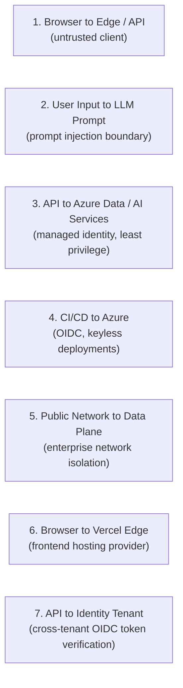

# MindGPT: Threat Model

This document outlines the threat modeling for MindGPT using the STRIDE methodology and aligns controls with the OWASP Top 10 for Large Language Models. MindGPT processes user-generated messages regarding mental health and emotional well-being (classified as special-category health data under GDPR Article 9) while exposing an LLM to untrusted conversational input.

**Author:** Haitam Oualif  
**Methodology:** STRIDE data-flow analysis, OWASP LLM Top 10 mapping, and residual risk assessment.

---

## 1. Assets and Data Classification

| Asset | Classification | Description & Sensitivity |
|---|---|---|
| Chat Messages | Sensitive (GDPR Special Category) | Mental health and emotional content; highest confidentiality requirement. |
| Uploaded Images | Sensitive | User photos or journal images; scanned for harmful content before storage. |
| User Profile | PII | Names, dates of birth, country, and preferences. |
| Sentiment & Wellness Aggregates | Sensitive | Derived metrics reflecting emotional trends; only numeric aggregates are stored. |
| Long-Term Memory Records | Sensitive | User-curated facts and context saved across sessions. |
| Identity & Auth Tokens | Secret (in transit) | Microsoft Entra External ID bearer JWTs. |
| Managed Identity Tokens | Secret | Azure platform credentials for internal service-to-service communication. |
| RAG Knowledge Corpus | Internal | Behavioral and psychoeducational guidance; integrity is critical to prevent advice poisoning. |

Because the core data consists of sensitive personal discussions, confidentiality and data integrity are prioritized throughout the architecture.

---

## 2. Trust Boundaries

Every user interaction crosses several of these boundaries. Boundaries 6 and 7 reflect platform configurations on Azure for Students subscriptions:
- Boundary 6 accounts for hosting the static frontend on Vercel because of student tenant deployment restrictions on Azure Static Web Apps ([ARCHITECTURE.md §10](./ARCHITECTURE.md#10-third-party-edge-vercel-outside-the-azure-tenant)).
- Boundary 7 accounts for hosting the Microsoft Entra External ID (CIAM) directory on an external tenant ([ARCHITECTURE.md §11](./ARCHITECTURE.md#11-identity-tenant-separation-entra-external-id-on-a-separate-account)).

---

## 3. STRIDE Threat Analysis

### Spoofing

| Threat Description | Boundary | Mitigation & Implementation |
|---|---|---|
| Forged or replayed authentication token | Boundary 1 | Backend validates Entra External ID JWTs (cryptographic signature, issuer URL, audience GUID, expiration). Short-lived tokens with refresh rotation. |
| Token from an untrusted Entra tenant | Boundary 7 | Token validation strictly enforces the exact issuer URL (`https://<tenantId>.ciamlogin.com/...`) and audience (`c1f92635…`), rejecting wildcard issuers. |
| Cross-tenant authorization bypass | Boundaries 1, 7 | Both API and SPA app registrations are configured as single-tenant (`AzureADMyOrg`). Tokens issued outside the dedicated CIAM directory are rejected. |
| Unauthorized trigger of scheduled retention cleanup | Boundary 1 | The cleanup task runs via an Azure Functions timer trigger using a managed identity, with no exposed public HTTP endpoint. |
| Service impersonation between Azure resources | Boundary 3 | Inter-service traffic uses Azure managed identities and Azure RBAC; shared access keys and passwords are disabled. |

### Tampering

| Threat Description | Boundary | Mitigation & Implementation |
|---|---|---|
| Client modifies `userId` to access another user's data | Boundaries 1, 3 | The server extracts `userId` exclusively from the verified token claim. Requests cannot override or spoof the identity claim. |
| Cross-user dashboard or memory manipulation | Boundaries 1, 3 | Stores (`profile`, `memory`, `wellness`) are partitioned by `/userId`. Data queries are strictly bound to the authenticated user's partition. |
| Knowledge base poisoning or indirect injection | Boundary 2 | Azure AI Content Safety Prompt Shields inspect retrieved documents before prompt assembly. Corpus excerpts are formatted as data, not instructions. |
| Pipeline or IaC modification to lower security | Boundary 4 | Bicep templates are scanned in CI/CD using automated linters; pull requests require review, branch protection, and pinned action commits. |
| Malicious code injection during frontend build | Boundary 6 | Branch protection on `main`, automated scanning via Dependabot and CodeQL, and locked dependency versions. |
| In-transit tampering | All | Strict HTTPS/TLS 1.2+ across all public and private endpoints. |

### Repudiation

| Threat Description | Boundary | Mitigation & Implementation |
|---|---|---|
| User denies performing an action or triggering an abuse event | All | Centralized logging in Azure Monitor / Application Insights with structured telemetry, correlation IDs, and PII masking. High-risk safety events (crisis flags, injection triggers) generate dedicated audit logs. |

### Information Disclosure

| Threat Description | Boundary | Mitigation & Implementation |
|---|---|---|
| Unauthorized access to uploaded journal images | Boundary 3 | Blob Storage public access is disabled at the account level. Access requires a time-limited User Delegation SAS token (1 hour maximum) issued only to the owner. |
| Direct object reference attack on storage blobs | Boundary 3 | Blob paths follow the structure `{userId}/{uuid}.ext`. SAS generation verifies that the path matches the authenticated user ID. |
| Sensitive message text leaking into application logs | Boundary 3 | Azure AI Language redacts Personally Identifiable Information (PII) before storage or logging. Full prompts are excluded from production traces. |
| Sentiment scoring exposes raw message text | Boundary 3 | Analysis runs within the secure Azure tenant boundary. Only derived numerical scores are persisted to Cosmos DB, never the analyzed text. |
| Detailed application error traces exposed to users | Boundary 1 | Exception handlers return standardized error models without stack traces or internal resource identifiers. |
| Cross-origin data leakage via wildcard CORS | Boundaries 1, 6 | CORS policy on the backend and APIM explicitly matches the production frontend origin, rejecting arbitrary domains. |
| Secret leakage via frontend client bundles | Boundary 6 | Only public client IDs and URLs are injected into the frontend build. No API keys or backend secrets exist in the client repository. |
| Accidental commit of secrets | Boundary 4 | `.gitignore` enforcement, secret scanning in CI (Gitleaks), and keyless Azure authentication via managed identities. |

### Denial of Service

| Threat Description | Boundary | Mitigation & Implementation |
|---|---|---|
| Unrestricted LLM calls causing high resource consumption | Boundaries 1, 2 | Per-user rate limiting enforced in FastAPI; the APIM gateway rejects unauthenticated requests at the network edge; character length limits enforced on chat messages. |
| Large or malicious payload uploads | Boundary 1 | Strict upload constraints (file size limits, permitted MIME types, image dimensions) enforced before blob writes. |
| Layer 7 denial of service on API endpoints | Boundary 1 | Container Apps dynamic scaling limits maximum replica counts to control compute usage. |

### Elevation of Privilege

| Threat Description | Boundary | Mitigation & Implementation |
|---|---|---|
| Prompt injection overriding core safety guardrails | Boundary 2 | System instructions and safety guidelines are isolated in the `system` role. User content is contained inside the `user` turn. Azure AI Content Safety Prompt Shields inspect inputs prior to model invocation. |
| Persistent prompt injection via stored memory | Boundary 2 | Stored memory entries are treated as structured data rather than executable instructions. |
| Over-privileged service identities | Boundary 3 | Dedicated managed identities per service with minimal RBAC roles (e.g. `Cognitive Services OpenAI User`, `Cosmos DB Built-in Data Contributor`). |
| Compromised deployment pipeline accessing Azure | Boundary 4 | OIDC federated credentials with short-lived tokens; GitHub Actions role scoped strictly to the deployment resource group. |

---

## 4. OWASP LLM Top 10 Alignment

| Vulnerability | Context & Risk | Implemented Control |
|---|---|---|
| LLM01: Prompt Injection | Direct manipulation via user input or indirect injection via retrieved context. | Azure AI Content Safety Prompt Shields, structured prompt templates, and explicit input delimitation. |
| LLM02: Insecure Output Handling | Model generating harmful content or unsafe markdown. | Azure AI Content Safety output analysis; safe markdown rendering in React without raw HTML injection. |
| LLM04: Model Denial of Service | Resource exhaustion via complex or repeated queries. | Per-user rate limiting, maximum token constraints, and message length caps. |
| LLM06: Sensitive Information Disclosure | Leaking private user data in prompts or completions. | Automated PII redaction (Azure AI Language), strict user data partitioning, and exclusion of prompts from logs. |
| LLM08: Excessive Agency | Model executing unwanted system actions or tool calls. | The LLM operates strictly in conversational mode without tool calling, external plugins, or write capabilities on the data plane. |
| LLM09: Overreliance | Inaccurate advice or failure to respond appropriately to crisis situations. | Deterministic pattern matching for crisis scenarios bypassing the model; explicit non-clinical disclaimers and immediate referral to professional hotlines. |

---

## 5. Known Limitations & Engineering Trade-Offs

- **Defense in Depth for Prompt Injection:** Content safety filters and prompt templates significantly mitigate adversarial prompts, but no probabilistic language model is immune to all jailbreaks. A deterministic crisis-detection layer runs before the model to ensure emergency situations are reliably handled.
- **Enterprise Network Isolation:** The application enforces keyless authentication, managed identities, and service-level firewall rules. Full Virtual Network integration with Private Endpoints is documented in `infra/modules/document/vnet-private-endpoints.bicep` as an enterprise architecture reference.
- **Multi-Tenant Identity Architecture:** Running the external CIAM directory in a separate tenant from the core Azure infrastructure requires relying on standard OIDC protocol validation rather than single-directory tenant policies. Both applications are registered as single-tenant apps to restrict access to authorized users.
- **Non-Clinical Boundary:** MindGPT provides supportive conversational reflections based on psychoeducational content. It does not provide clinical diagnosis or therapeutic treatment, and user-facing notifications make this boundary explicit.
